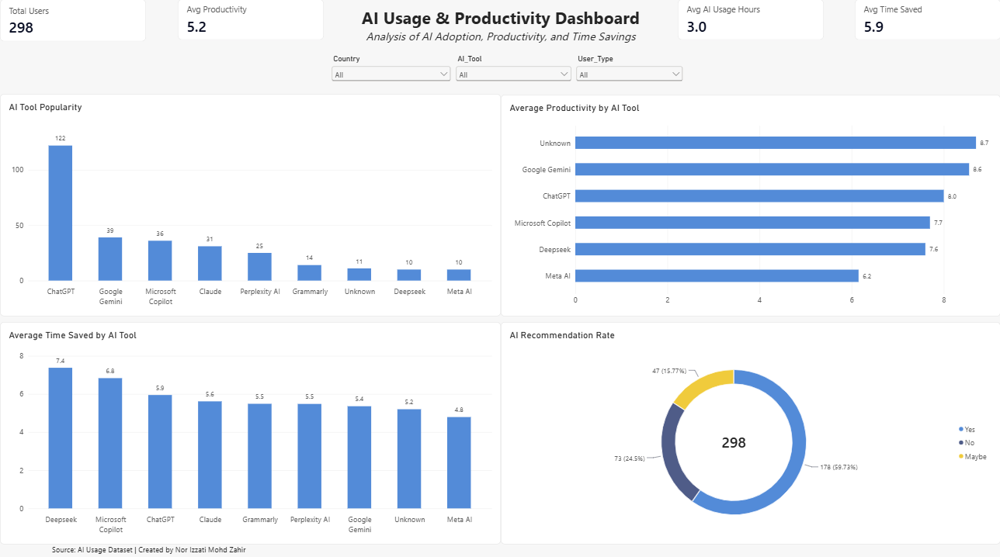

# AI Usage Analysis & Productivity Dashboard

## Project Overview

This project analyzes AI adoption patterns, productivity impact, and time-saving benefits using SQL and Power BI.

The project combines data analysis and dashboard visualization to identify the most popular AI tools, measure productivity improvements, and understand user recommendations.

## Dashboard Preview

---

## Tools Used

- SQL
- SQLite Online
- Power BI
- GitHub

---

## SQL Analysis

Key business questions answered:

1. Total users in the dataset
2. Most popular AI tools
3. AI usage by profession
4. Productivity by profession
5. Average time saved
6. Top-performing users
7. Productivity by AI tool
8. Age group analysis

---

## Power BI Dashboard Features

### KPI Cards

- Total Users
- Average Productivity
- Average Daily AI Usage
- Average Time Saved

### Visualizations

- AI Tool Popularity
- Average Productivity by AI Tool
- Average Time Saved by AI Tool
- AI Recommendation Rate

### Interactive Filters

- Country
- AI Tool
- User Type

---

## Key Insights

- ChatGPT is the most widely used AI tool.
- Google Gemini and ChatGPT show strong productivity outcomes.
- Deepseek demonstrates the highest average time savings.
- Most users would recommend AI tools to others.

---

## Project Files

- AI_Usage_Analysis.sql
- ai_usage.csv
- AI_Usage_Dashboard.png

---

## Author

Nor Izzati Mohd Zahir

Aspiring Data Analyst focused on SQL, Excel, and Power BI projects.
